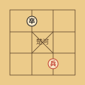
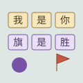
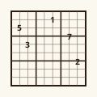
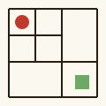

<div align="center">

# 快乐小游戏 · Happy Games

**24 款免安装小游戏 · 零框架 · 零构建 · 零依赖 · AI 对弈 · 在线联机**

> 不必找游戏，直接开始一局。

[🎮 在线试玩](https://happygames.pages.dev) · [✍️ 作者博客](https://zhoujungis.github.io/) · [📧 联系](mailto:no-reply@gmail.com)

</div>

---

## 📖 这是什么

**快乐小游戏**是一个纯用**原生 HTML / CSS / JavaScript** 写成的浏览器游戏厅。没有 React，没有 Vue，没有打包器，连一行构建脚本都没有——整个项目就是一堆可以双击打开的 HTML 文件，上传到 Cloudflare Pages 之后，就变成人人都能点开的线上版本。

这个项目把童年的桌游、烧脑的谜题、随手把玩的休闲小游戏，和整个华夏历史，一起装进了四个板块、二十四款游戏：

| 板块 | 主题 | 游戏 |
|:---:|:---|:---|
| ♟️ **棋类竞技** | 方寸棋盘，纵横谋略 | 五子棋、中国象棋、围棋、斗兽棋、黑白棋、飞行棋 |
| 🧩 **益智解谜** | 逻辑推理，烧脑一刻 | 规则方块、光线折射、数独、迷宫逃脱、回声行者、推箱子 |
| 🎈 **娱乐天地** | 随手把玩，偷得半日闲 | 星火割草、模拟人生、跳跳鸟、模拟徒步、跳一跳、堆塔 |
| 🏯 **华夏历史** | 数风流人物，还看今朝 | 圣旨七日、华夏商旅、大唐县令、华夏帝王、华夏大乱斗、科举闯关 |

你可以在 15×15 的棋盘上与 AI 厮杀五子，可以让编译成 WebAssembly 的 GNU Go 引擎陪你下围棋，可以约上朋友在飞行棋房间里实时联机，也可以让 AI 替你把一生写下去——从出生属性开始，走到人生落幕。

**设计原则：**

- **自包含**——每款游戏一个文件夹，页面、样式、逻辑、AI 全在一起，互不干扰；
- **纯函数隔离**——游戏 AI 全部写成不碰 DOM 的纯函数（`ai.js` / `engine.js`），浏览器里能跑，`node --test` 也能直接测；
- **数据驱动首页**——所有游戏信息集中在 `shared/landing.js` 一份配置里，加一款游戏只改一处，首页、板块页、每日推荐自动生效；
- **能离线**——除 AI 叙事和联机外，绝大多数游戏不依赖网络，静态资源即点即玩。

---

## 🎮 游戏全览

### ♟️ 棋类竞技

| 预览 | 游戏 | 详细介绍 |
|:---:|:---|:---|
|  | **五子棋** | 经典 15×15 人机对战。AI 基于模式评分（连五、活四、冲四、活三等 8 档棋形权重），三档难度对应不同搜索深度，初级会"手滑"，高级算无遗策 |
|  | **中国象棋** | 人机对弈，内置移植自开源项目的 alpha-beta 搜索引擎，配 9 种棋子的位置价值表（如马 3.5、车 9、炮 4.5 的棋力配点），另有云端 AI 走法代理兜底 |
|  | **围棋** | 人机对弈，内置 **GNU Go**——把开源围棋引擎编译成 WebAssembly（约 8.7 MB），在 Web Worker 中异步运行，Komi 7.5 贴目，落子节奏与真实对局无异 |
|  | **斗兽棋** | 经典河流与陷阱规则：象吃狮、鼠吃象、老鼠过河、陷阱困兽。三档人机对战，棋盘绘有 🦁🐯🐰🐶🐱🐭 动物棋子 |
|  | **黑白棋** | 翻转对手棋子，八方向夹击。三档 AI 难度，支持悔棋，绿底棋盘上的黑白博弈干净利落 |
|  | **飞行棋** | 唯一一款在线联机游戏：2–4 人实时对战，掷骰、跳格、飞格全按经典规则，人不够时空座由 AI 补位，随时开局不等人 |

### 🧩 益智解谜

| 预览 | 游戏 | 详细介绍 |
|:---:|:---|:---|
|  | **规则方块** | 棋盘上的文字不是说明，而是规则本身："墙"会阻挡移动，"水"会吞没棋子，"停"会定住你。推开文字方块就能改写世界的运行规则——目标是让任意「你」与任意「胜」相遇。右侧实时显示当前生效的规则，多关卡可选，支持撤销与重置 |
|  | **光线折射** | 深色网格上旋转镜面与分光器，让一束激光经过折射、分光，点亮棋盘上全部晶体。45° 旋转交互，每一步都在和光学原理斗智 |
|  | **数独** | 经典 9×9 数独，三档难度（简单/中等/困难），限时挑战。铅笔标记、高亮同行同宫冲突，干净的米白棋盘风格 |
|  | **迷宫逃脱** | 限时穿越随机生成的迷宫，难度越高迷宫越大越曲折。每局地图都不同，手速与方向感双重考验 |
|  | **回声行者** | 独特的"影子机制"：每走六步，你曾走过的旧路会变成巡游的回声追赶你。收集红色印章、避开过去的自己，路线规划稍有差错就会被自己堵死 |
|  | **推箱子** | 经典推箱子解谜，15 个手排关卡由浅入深。箱子、目标点、墙面一目了然，地板色系温暖复古 |

### 🎈 娱乐天地

| 预览 | 游戏 | 详细介绍 |
|:---:|:---|:---|
|  | **星火割草** | 类"吸血鬼幸存者"玩法：角色自动射击，怪潮四面八方围攻，击杀掉落经验，随机三选一升级构筑（加射速、加弹道、加护甲……），能撑几波全看 build 的运气与取舍 |
|  | **模拟人生** | 从出生走到落幕的文字人生模拟。开局分配天赋属性（智识、体魄、财运……），随后 AI 依据属性流式生成童年、少年、青年、中年、晚年五个阶段的故事，最后给出 0–100 的人生评分——每次出生，都是完全不同的一生 |
|  | **跳跳鸟** | 点击屏幕让小鸟飞翔，穿过水管缝隙，越飞越远。经典手感 + 蓝天草地配色，随时随地来一局 |
|  | **模拟徒步** | 三条真实经典路线：熬太穿越、贡嘎大环线、乌孙古道。翻山越岭、补给管理、海拔与天气，把徒步的滋味装进浏览器 |
|  | **跳一跳** | 长按蓄力、松手起跳，棋子从一个平台跳到下一个平台。正落平台中心有连击加分，手感微妙的物理引擎是精髓 |
|  | **堆塔** | 看准时机让左右摆动的方块落下，对齐越多层越高。精准截断、层层堆叠，越高心跳越快 |

### 🏯 华夏历史

| 预览 | 游戏 | 详细介绍 |
|:---:|:---|:---|
|  | **圣旨七日** | 身为朝臣，七天之内办妥圣旨。每天三次行动机会，从行动卡中选择，银两、粮食、民心、治安、士族、名望、情报七项资源此消彼长；三次行动后呈报当日圣旨，达标得赏，失守满盘皆输。第七日按全局政绩结算 |
|  | **华夏商旅** | 踏遍古今名城经营商号，与三名 AI 商人争夺天下财富。商品、价格、对手的买卖策略都在变化，低买高卖与垄断是制胜之道 |
|  | **大唐县令** | 从一介县令做起：修农田、兴市集、处理政务与随机事件，经营一城十二季（三年）。税收、民心、粮仓、治安的多目标平衡，是微缩版的城市管理模拟 |
|  | **华夏帝王** | 猜一位古代帝王：200 余位候选，不限次数。前几次只能得到年代、朝代、功绩之类的常规线索，第 5 次起有 50% 概率直接揭示属性对比——文史知识大比拼 |
|  | **华夏大乱斗** | 双人轮流选将：穿越到随机朝代，从英雄池中为十个职位（先锋、后勤……）挑选最合适的历史人物。选将完毕由 AI 历史裁判逐局评判，十局对决后给出总分与说书人风格的点评——不是名气大的赢，是匹配朝代的赢 |
|  | **科举闯关** | 从县试到殿试共七关，每关三题四选一，答错即止。题型覆盖经史子集与古代制度常识，通关者金榜题名——殿试三甲是读书人的终极浪漫 |

---

## 🚀 硬核亮点

### 🤖 AI 引擎：从模式评分到 WebAssembly

这个项目的 AI 不是"随机走一步"式的敷衍，而是从简单到极致跨越了四个技术层级：

**① 模式评分（五子棋）**

五子棋 AI 在 8 个方向扫描棋形，按权重打分后取最优落点：

| 棋形 | 评分 |
|:---|:---:|
| 连五 | 100000 |
| 活四 | 10000 |
| 冲四 / 活三 | 1000 |
| 冲三 / 活二 | 100 |
| 冲二 | 10 |
| 单子 | 1 |

三档难度控制搜索深度——初级只看一步，高级多看几步并把"堵你活三"放在"自己成冲四"之上。

**② Alpha-beta 剪枝（中国象棋）**

象棋引擎移植自开源项目 [itlwei/Chess](https://github.com/itlwei/Chess)（MIT），保留引擎核心：走法生成（bylaw）、位置价值表（每枚棋子在不同位置的攻防价值）、alpha-beta 搜索 + 局面评估。棋盘逻辑（`logic.js`）与 AI 引擎（`engine.js`）完全分离，另在服务端（`/api/xiangqi-ai`）提供基于 GLM-4.7-Flash 的 AI 走法代理作为兜底。

**③ GNU Go → WebAssembly（围棋）**

围棋 AI 走了一条"硬核"路线：把开源围棋引擎 **GNU Go** 编译成 WebAssembly（`weiqi/gnugo.js`，约 8.7 MB），在 Web Worker 中运行。主线程通过消息协议与引擎通信：

```
主线程 → Worker：  { cmd: 'init', size, seed }   初始化对局（Komi 7.5）
主线程 → Worker：  { cmd: 'play', i, j }         玩家落子
主线程 → Worker：  { cmd: 'genmove' }            引擎思考落子
Worker → 主线程：  { ok, cmd, board, last }      盘面快照（含颜色归一化）
```

Worker 里还做了颜色归一化（不依赖 GNU Go 内部颜色常量方向）、走法日志（引擎崩溃时可复现对局）、stdout/stderr 捕获（便于诊断）。这是"浏览器里跑世界级棋类引擎"的完整实践。

**④ 三档难度全家桶（斗兽棋 / 黑白棋）**

两款的 AI 都按搜索深度分三档，黑白棋额外支持悔棋，连 AI 打错一步都能退回去重想。

### 🌐 飞行棋：基于 D1 的实时联机

飞行棋是项目里唯一的多人游戏，架构可拆成三层：

- **房间管理**——`/api/feixingqi/create`、`/api/feixingqi/join` 创建与加入房间，房间带密码，状态序列化为 JSON 存进 D1（`feixingqi_rooms` 表，含 `created_at` / `updated_at` 时间戳）；
- **状态推进**——`/api/feixingqi/roll` 掷骰、`/api/feixingqi/move` 走子、`/api/feixingqi/start` 开局，所有走子合法性由服务端校验，防作弊；
- **轮询同步**——前端每 1.5 秒（对局中）/ 2 秒（大厅）轮询 `/api/feixingqi/state`，服务端在返回前先执行 `tick()` 推进 AI 补位玩家的回合，玩家看到的永远是"别人已经走完"的最新局面。

联机之外，空座由服务端 AI 托管——哪怕只有一个人，也能凑齐一桌飞行棋。

### 🪄 AI 流式叙事：人生与战报由大模型书写

「模拟人生」与「华夏大乱斗」把大模型接进了游戏：

- **模拟人生**：玩家分配出生属性后，请求 OpenRouter（`inclusionai/ling-3.0-flash:free`），服务端把 SSE 流原样转发给浏览器，六段人生（童年→少年→青年→中年→晚年→总评）逐字生成，像有人在屏幕那头讲故事。遇 429 限流自动退避重试（最多 3 次），提示词严格约束输出格式（每段 130–180 字、评分必须为"人生评分：NN"）；
- **华夏大乱斗**：AI 担任"历史裁判"，按朝代适配性 > 职位匹配度 > 实际能力 > 阵容协同的优先级逐局评判十场对决，比分精确到 0.1 且每局总和必须为 10，输出风格是"话说……""且看……"的说书人腔调。

### 🔐 账号与管理台

- 注册 / 登录 / 退出，密码存储于 D1 `users` 表，会话使用随机 token + Cookie（`hg_token`）鉴权，`expires_at` 过期校验；
- `/api/me` 供前端判断登录态：首页据此显示"用户名 · 退出"；管理员账号（`zhoujun`）自动亮出隐藏的「管理台」入口；
- 管理台在 `adminPages/` 下，`/api/admin/users` 提供用户管理接口。

### ⚡ 快得没有道理

- 全站零依赖、零构建，静态资源秒开；`_headers` 配置了分层缓存：`.css/.js` 5 分钟 + stale-while-revalidate 24 小时，`.wasm` 7 天 immutable（GNU Go 引擎一次加载永久缓存），图片类资源缓存 1 天；
- 首页每次打开随机抽 3 款游戏做推荐位，另有「随机开一局」按钮——选择困难症救星；
- 布局响应式，手机电脑皆可玩，触屏游戏适配点击与按键两种输入。

---

## 🛠 技术栈

| 层 | 技术 |
|:---|:---|
| 前端 | 原生 HTML / CSS / JS（ES Modules），无框架、无构建、无依赖 |
| 棋盘渲染 | 手写 SVG / Canvas（视游戏而定） |
| AI | GNU Go → WebAssembly（Worker 运行）、alpha-beta 剪枝、模式评分、minimax |
| 云端 AI | OpenRouter（LLM 流式叙事与战局分析）、GLM-4.7-Flash（象棋走法代理） |
| 后端 | Cloudflare Pages Functions（`functions/api/**`，按路径自动路由） |
| 数据库 | Cloudflare D1（SQLite 云数据库，`schema.sql` 建表） |
| 测试 | Node.js 内置 test runner（`npm test`，`tests/` 下 25 个测试文件）+ Playwright 冒烟测试 |
| 部署 | Cloudflare Pages（wrangler CLI） |
| 缓存 | `_headers` 静态资源分层缓存 |

---

## 🏗 架构详解

### 前端架构

```
┌─────────────────────────────────────────────────────┐
│  index.html  首页：板块入口卡 + 每日推荐 + 随机开一局   │
│  /board /puzzle /fun /history  板块页：该板块游戏卡    │
│  shared/landing.js  唯一数据源：板块 + 游戏配置 + SVG  │
│  shared/game-runtime.js  生命周期、分数与反馈事件队列    │
│             预览图（渲染首页与板块页的纯函数）          │
├─────────────────────────────────────────────────────┤
│  每款游戏 = 一个自包含文件夹                            │
│  <game>/index.html   页面骨架 + 弹窗说明               │
│  <game>/<game>.js    交互与渲染（可含 worker）         │
│  <game>/<game>.css   独享样式                         │
│  <game>/ai.js        纯函数 AI（无 DOM，可单测）       │
│  <game>/engine.js    纯逻辑引擎（走法/规则/状态机）     │
└─────────────────────────────────────────────────────┘
```

- **主题共享**：`shared/theme.css` 定义全套视觉变量（墨色、朱红、金色、青绿色等），`shared/cards.css` 定义首页与板块页卡片样式，`shared/game.css` 定义游戏页布局与状态反馈；
- **运行时共享**：`shared/game-runtime.js` 为游戏创建会话、记录关键事件、同步分数快照，并在结束/离页时提交结果；网络失败不会阻塞游戏主循环；
- **每款游戏独立成套**：新增游戏只动两个地方——建文件夹、加一行配置，其余全部自动生效。

### 后端 API 参考

所有接口都在 `functions/api/` 下，文件名即路由：

| 端点 | 方法 | 说明 |
|:---|:---:|:---|
| `/api/register` | POST | 注册新用户 |
| `/api/login` | POST | 登录，下发 `hg_token` Cookie |
| `/api/logout` | POST | 退出登录，销毁会话 |
| `/api/me` | GET | 当前登录态（用户名 or 401） |
| `/api/xiangqi-ai` | POST | 象棋 AI 走法代理（GLM-4.7-Flash），FEN 进、走法出 |
| `/api/life/narrate` | POST | 模拟人生：依据出生属性流式生成人生（SSE） |
| `/api/battle/create` `join` `pick` `state` | POST/GET | 华夏大乱斗：房间、选将、状态同步 |
| `/api/battle/analyze` `analysis` | POST/GET | 华夏大乱斗：AI 裁判逐局评判（SSE 流式） |
| `/api/feixingqi/create` `join` `start` `roll` `move` `state` | POST/GET | 飞行棋：房间、开局、掷骰、走子、轮询状态 |
| `/api/admin/users` | GET | 管理台：用户列表 |
| `/api/game/sessions` | POST | 创建一局游戏会话 |
| `/api/game/events` | POST | 批量写入关键游戏事件，支持幂等 |
| `/api/game/finish` | POST | 结算游戏并写入成绩 |
| `/api/admin/game-stats` | GET | 管理台：游戏对局与成绩统计 |

通用中间件在 `functions/_middleware.js`，`functions/api/feixingqi/_shared.js` 提供 `json()`、`loadRoom()`、`saveRoom()`、`whoami()` 等复用工具。

### 数据库（D1）

`schema.sql` 定义了账号、联机和游戏数据表：

```sql
users            -- 用户名 + 密码 + 注册时间
sessions         -- 会话 token + 用户名 + 过期时间
battle_rooms     -- 大乱斗房间：code/password/state(JSON)/时间戳
feixingqi_rooms  -- 飞行棋房间：同上结构
game_sessions    -- 每局游戏的生命周期、状态、最终分数
game_events      -- 受白名单约束的关键游戏事件
game_scores      -- 最终成绩、结算结果和时长
```

增量变更放在 `migrations/`，新数据库可执行完整 `schema.sql`，已有数据库按迁移文件顺序更新。

房间状态整体序列化为 JSON 存在单行里（简单够用），联机走"前端轮询 + 服务端状态机推进"模型，D1 即数据库即缓存。

---

## 🚀 快速开始

需要 **Node.js 18+**（wrangler 与测试都依赖它）。

```bash
npm install
npm run dev
```

打开 http://localhost:8788 即可游玩。`wrangler pages dev .` 会同时提供静态资源与 Pages Functions（本地 D1 需要先 `wrangler d1 migrations apply` 或 dashboard 创建绑定，见下文部署）。

## 🧪 测试

```bash
npm test
```

使用 Node 内置 test runner 运行 `tests/*.test.js`，共 **25 个测试文件、288 个测试**，覆盖各游戏 AI 模块、反馈服务和整体性能测试。浏览器冒烟测试使用 `npm run test:e2e`，覆盖桌面与移动端首页、Canvas 游戏和横向溢出。之所以能在 Node 里测，是因为所有 AI / 引擎都写成**不依赖 DOM 的纯函数**（`gomoku/ai.js`、`xiangqi/engine.js`、`weiqi/logic.js` 等）。

## ☁️ 部署

```bash
npm run deploy
```

- 首次运行会创建 `happygames` Pages 项目（wrangler.toml 中 `name = "happy-games"`，`pages_build_output_dir = "."` 即整站直接发布）；
- 项目依赖 D1 数据库 `happy-games-db`：先在 Cloudflare dashboard 创建同名数据库，把 `database_id` 填入 `wrangler.toml`，再执行 `schema.sql` 建表；
- AI 叙事接口需要环境变量 `OPENROUTER_KEY`（在 Pages 项目设置 → Variables 中配置）；
- 域名与 HTTPS 由 Cloudflare 自动处理，发布后访问 https://happygames.pages.dev（或绑定的自定义域名）。

## 🆕 新增一款游戏

1. **建文件夹**：创建 `<game>/`，参考 `gomoku/` 的结构：

   ```
   <game>/
   ├── index.html     # 页面骨架（头部 + 棋盘 + 规则弹窗）
   ├── <game>.css     # 游戏独享样式
   ├── <game>.js      # 交互与渲染
   └── ai.js          # 纯函数 AI（可被 node --test 测试）
   ```

2. **注册配置**：在 `shared/landing.js` 对应板块的 `games` 数组中加一条：

   ```js
   {
     id: 'mygame',           // 文件夹名，也是 /mygame/ 的路径
     name: '我的游戏',         // 卡片标题
     description: '一句话简介', // 首页与卡片上的描述
     href: '/mygame/',        // 跳转链接
     accent: '#2980b9',       // 卡片主题色
     previewSvg: `<svg ...>`, // 120×120 的 SVG 预览图
   }
   ```

3. **（可选）后端接口**：按需放在 `functions/api/` 下，文件名即路由：

   ```
   functions/api/leaderboard.js  →  GET/POST /api/leaderboard
   ```

   完成。首页板块卡、板块页游戏卡、每日随机推荐、随机开一局都会自动带上新游戏，不需要改任何其他文件。

---

## 📁 项目结构

```
├── index.html                  # 首页：板块入口 + 每日推荐 + 随机开一局
├── login.html                  # 登录/注册页
├── adminPages/                 # 管理台
├── shared/
│   ├── theme.css               # 全局视觉变量与基础样式
│   ├── cards.css               # 首页/板块页卡片样式
│   ├── game.css                # 游戏页公共样式（页头、弹窗）
│   ├── game-runtime.js          # 游戏生命周期、分数与事件上报
│   └── landing.js              # ★ 唯一数据源：板块+游戏配置+SVG 预览图
├── functions/
│   ├── _middleware.js          # 通用中间件
│   ├── services/                # 游戏会话与反馈业务服务
│   ├── repositories/            # D1 数据访问边界
│   └── api/
│       ├── register.js login.js logout.js me.js   # 账号体系
│       ├── xiangqi-ai.js       # 象棋 AI 走法代理
│       ├── life/narrate.js     # 模拟人生 SSE 叙事
│       ├── battle/*.js         # 华夏大乱斗房间与 AI 裁判
│       ├── feixingqi/*.js      # 飞行棋联机（_shared.js 为公共工具）
│       └── admin/               # 管理台接口与游戏统计
├── <game>/                     # 每款游戏一个自包含文件夹
│   ├── index.html
│   ├── <game>.js / <game>.css
│   ├── ai.js / engine.js / logic.js   # 纯函数逻辑
│   └── (worker 文件，如 weiqi/weiqi.worker.js、gnugo.js)
├── schema.sql                  # D1 数据库表结构
├── migrations/                  # D1 增量迁移
├── tests/                       # Node 逻辑/API 测试
├── e2e/                         # Playwright 浏览器冒烟测试
├── tools/check.mjs              # 代码质量基础检查
├── wrangler.toml               # Pages + D1 配置
├── _headers                    # 静态资源缓存策略
├── _routes.json                # 路由配置
├── assets/                     # README 游戏预览图（由 landing.js 导出）
└── docs/architecture.md         # 架构边界与迁移规则
```

---

## 📜 License

Private project · © 2026 Zhou Jun · Built with Cloudflare
